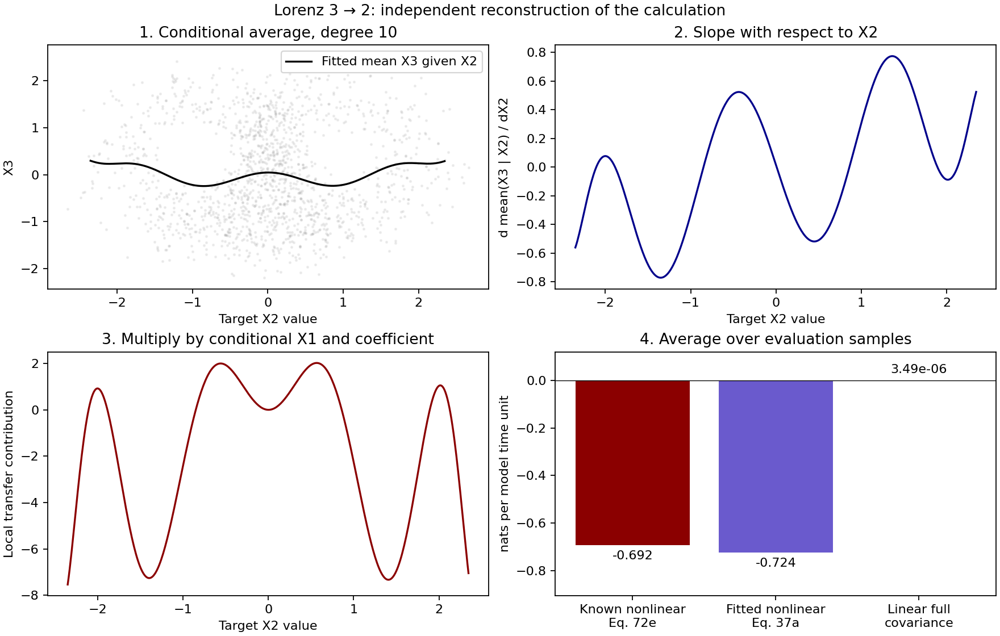

# Pires–Docquier–Vannitsem: from observations to nonlinear information transfer

This guide follows **A general theory to estimate information transfer in nonlinear systems**, Carlos A. Pires, David Docquier and Stéphane Vannitsem, Physica D 458, 133988 (2024), [DOI](https://doi.org/10.1016/j.physd.2023.133988).

**Equation numbers and PDF pages refer to [arXiv:2307.10623v2](https://arxiv.org/pdf/2307.10623v2), revised October 2023, 51 pages.** The local [paper dump](../../papers/lk-curated-library/09-pires-2024/paper-dump.md) was also checked. Independent learning guide; not author-reviewed.

## 1. Calculation sequence

The authors start with simulated systems whose equations they know. That lets them compare methods. In one experiment they hide the equations from the estimator and fit them from the simulated observations.

They then perform **two different fits**:

1. Fit how each state variable changes: the process equation.
2. Fit how averages of other variables depend on the target variable: conditional-average curves.

They differentiate the second set of curves and combine the slopes with terms from the first equation. Averaging produces a rate of entropy transfer.

Their Lorenz demonstration uses polynomial functions. A DNN or wavelet network is not required to follow this example.

## 2. What each mathematical object means

| Object | Meaning | Where it comes from |
|---|---|---|
| \(X=(X_1,\ldots,X_D)\) | The physical variables being studied | Observed or simulated state samples |
| \(F_i(X,t)\) | Expected short-time change rate of variable \(i\) at that state | Known equation or fitted dynamics |
| \(B_{ik}(X,t)\) | Amplitude with which noise source \(k\) enters variable \(i\) | Known noise law or an inference procedure |
| \(g=BB^{\mathsf T}\) | Covariance rate of process-noise increments | Diffusion fit or known model |
| \(\rho(X,t)\) | Joint distribution of the state at time \(t\) | Ensemble or representative trajectory samples |
| \(E[V\mid U=u]\) | Average of \(V\) among states whose \(U\) is near \(u\) | A regression curve fitted from paired samples |
| \(T_{j\to i}\) | LK entropy-transfer rate from driver \(j\) to target \(i\) | The calculation below |

\(B\) itself is not the state covariance. It controls the random increments in the process equation. The covariance rate of those increments is \(g\).

## 3. Start at Equation 1: the nonlinear process model

Read PDF page 3, Equation 1:

\[
dX_i=F_i(X,t)\,dt+\sum_{k=1}^{D}B_{ik}(X,t)\,dW_k.
\]

The right side may be nonlinear in the state. Terms such as \(X_1X_3\), \(X_2^2\), or smooth nonlinear functions can appear in \(F_i\). Writing a coefficient multiplying \(dt\) does not make an equation linear.

Over a small sampling interval this gives the approximation

\[
X_{i,n+1}-X_{i,n}
\approx F_i(X_n,t_n)\Delta t
+\sum_k B_{ik}(X_n,t_n)\sqrt{\Delta t}\,\varepsilon_{k,n}.
\]

The state is sampled at discrete times, but the underlying model is a continuous-time SDE.

## 4. What entropy is changing?

The target's marginal differential entropy is

\[
H_i(t)=-\int \rho_i(u,t)\log\rho_i(u,t)\,du.
\]

Here \(u\) runs over possible values of variable \(i\). It is not the time axis.

Equation 5 describes how the full state distribution evolves:

\[
\frac{\partial\rho}{\partial t}
=-\sum_j\frac{\partial(F_j\rho)}{\partial x_j}
+\frac12\sum_{j,k}\frac{\partial^2(g_{jk}\rho)}{\partial x_j\partial x_k}.
\]

The authors insert this distribution evolution into the entropy calculation and integrate. Equation 6 separates deterministic and stochastic entropy-change terms. Their boundary assumptions matter: vanishing densities, suitable closed boundaries, or periodic boundaries remove boundary flux terms. PDF pages 4–5 discuss when additional boundary terms are necessary.

The later slope formula rearranges this entropy calculation.

## 5. Entropy change and entropy transfer are different numbers

Their entropy budget can be written

\[
\frac{dH_i}{dt}
=\text{self entropy generation}
+T_{X_{\sim i}\to X_i}.
\]

Here \(X_{\sim i}\) means all variables other than \(i\). Equations 4 and 8 specify the budget. In a stationary distribution the left side is zero, but the transfer and self terms can balance at nonzero values.

Consequently, subtracting the target's entropy at two dates gives its overall change. It does not directly give a particular driver's transfer.

Individual drivers in larger systems require Section 3, used below for Lorenz.

## 6. Equation 11: where the two slopes come from

First consider **two variables**, with target \(X_1\) and driver \(X_2\), and deterministic contribution \(F_1\). Define the fitted average curve

\[
m(u)=E[F_1(X_1,X_2)\mid X_1=u].
\]

Equation 11, PDF page 6, gives the deterministic transfer in this setting as

\[
T_{2\to1,F}
=E[m'(X_1)]
-E\!\left[\frac{\partial F_1}{\partial x_1}(X_1,X_2)\right].
\]

The paper writes this using the part of \(F_1\) that depends on the other variables. Using the full \(F_1\) here gives the same result because target-only terms cancel.

The two derivatives ask different questions:

- \(m'(u)\): when the target value changes, how does the fitted **average** change? The conditional distribution of the driver also changes along that curve.
- \(\partial F_1/\partial x_1\): how does the process function change when only \(x_1\) changes and the other input is held fixed?

This identity explains their difference. With \(p(v\mid u)\) the conditional density,

\[
m(u)=\int F_1(u,v)p(v\mid u)\,dv,
\]

so

\[
m'(u)
=\int\frac{\partial F_1(u,v)}{\partial u}p(v\mid u)\,dv
+\int F_1(u,v)\frac{\partial p(v\mid u)}{\partial u}\,dv.
\]

Subtracting the first term and averaging over \(u\) leaves the dependence contribution. That is the connection to Equation 10a.

Derived from the entropy budget, the slope identity gives transfer directly, without subtracting two estimated entropies.

**The prime is a slope with respect to a state value. It is not a derivative with respect to time.**

For a polynomial fit

\[
\widehat m(u)=c_0+c_1u+c_2u^2,
\]

the required slope is simply

\[
\widehat m'(u)=c_1+2c_2u.
\]

No numerical time derivative of this curve is involved.

In more than two dimensions, Equation 11 describes **collective** transfer from the other variables. An individual driver needs the Section 3 formulas.

This also connects to the familiar linear result: if \(F_1=a_{11}X_1+a_{12}X_2\), the two-slope formula leaves \(a_{12}\,dE[X_2\mid X_1]/dX_1\). For jointly Gaussian states the conditional slope is \(C_{12}/C_{11}\), giving \(T_{2\to1}=a_{12}C_{12}/C_{11}\). A nonlinear process generally needs the actual conditional curves rather than replacing them with that covariance ratio.

## 7. When the process equation is unknown: fit it

Read Section 4.3, Equations 47–50, PDF pages 19–20, then Appendix B.1, PDF pages 46–47.

The fitting observations are paired states and short-time change rates:

\[
v_{i,n}=\frac{X_{i,n+1}-X_{i,n}}{\Delta t}.
\]

For an SDE this is an observed increment rate, not a claim that a white-noise trajectory has an ordinary derivative.

The authors represent the drift using a chosen family:

\[
\widehat F_i(X)=\sum_{\ell}\theta_{\ell,i}\Psi_\ell(X).
\]

For the Lorenz experiment, Section 6.2 uses these ten monomials:

\[
1,\ X_1,\ X_2,\ X_3,\ X_1^2,\ X_1X_2,\ X_1X_3,\ X_2^2,\ X_2X_3,\ X_3^2.
\]

Build one row of these features for each observed state. Fit coefficients by least squares against \(v_i\). Appendix B.1 supplies the corresponding normal-equation expression.

Although coefficient fitting is linear in \(\theta\), the resulting process model is nonlinear in \(X\). The product \(X_1X_3\) remains nonlinear.

This fit is separate from the later conditional regressions. In Section 6.2, the drift basis has degree at most two, while conditional-average regressions use degree ten.

## 8. Where the noise fit enters

With fitted drift, define the increment residual

\[
r_{i,n}=X_{i,n+1}-X_{i,n}-\widehat F_i(X_n)\Delta t.
\]

For a well-specified short-time SDE approximation,

\[
E[r_{i,n}^2\mid X_n=x]\approx g_{ii}(x)\Delta t.
\]

Thus one can fit \(g_{ii}\) from conditional squared residuals divided by \(\Delta t\). Equivalently, if the residual was computed from the change **rate** \(v_i-\widehat F_i\), multiply its squared value by \(\Delta t\). This factor appears in Appendix B.1.

The Lorenz MF experiment uses the noise basis \(\{1,\exp(-X_1^2)\}\). A fitted diffusivity must remain nonnegative. Squaring errors alone does not prove that their source is physical process noise: numerical approximation, missing variables, measurement error, and drift misspecification also leave residuals.

The diagonal \(g_{ii}\) is sufficient for the marginal stochastic-transfer formulas used here. It does not uniquely identify the complete matrix \(B\).

## 9. Now follow one actual nonlinear Lorenz link

The paper uses \(\sigma=10\), \(R_a=27\), and \(\beta=8/3\). The state variables are standardized using approximately

\[
\mu=(0,0,22.61),\qquad s=(7.74,8.76,8.35).
\]

We write standard deviations as \(s_i\), to avoid confusing them with the Lorenz parameter \(\sigma\). The paper writes them as \(\sigma_i\).

Equation 71b is

\[
dX_2=
\left[
\frac{s_1}{s_2}(R_a-\mu_3)X_1
-\frac{s_1s_3}{s_2}X_1X_3
-X_2
\right]dt+B_2\,dW_2.
\]

The driver of interest is \(X_3\); the target is \(X_2\). The term depending on \(X_3\) is

\[
F_{2,3}=-kX_1X_3,\qquad k=\frac{s_1s_3}{s_2}.
\]

The third variable \(X_1\) remains in the calculation.

## 10. Apply Equation 37a term by term

Equation 37a, PDF page 14, gives the individual deterministic transfer for a separable term of the form

\[
F_{i,j}=f_j(X_j)\,f_i(X_i)\,f_o(X_o)
\]

as

\[
T_{j\to i,F}
=E\!\left[
f_i(X_i)\,E[f_o(X_o)\mid X_i]\,
\frac{d}{dX_i}E[f_j(X_j)\mid X_i]
\right].
\]

For the Lorenz term, choose \(f_j(X_3)=X_3\), \(f_i(X_2)=1\), and \(f_o(X_1)=-kX_1\).

Define two curves:

\[
a(u)=E[X_1\mid X_2=u],\qquad
b(u)=E[X_3\mid X_2=u].
\]

The formula becomes the paper's **Equation 72e**, PDF page 29:

\[
T_{3\to2,F}=-k\,E[a(X_2)b'(X_2)].
\]

Compute it as follows:

1. Take the paired samples \((X_{1,n},X_{2,n},X_{3,n})\).
2. Regress \(X_1\) against \(X_2\), obtaining \(a(u)\).
3. Regress \(X_3\) against \(X_2\), obtaining \(b(u)\).
4. Differentiate the fitted \(b\) curve.
5. At every sampled \(X_{2,n}\), evaluate \(a(X_{2,n})b'(X_{2,n})\).
6. Average those products and multiply by \(-k\).

The sample estimate is

\[
\widehat T_{3\to2,F}
=-\frac{k}{N}\sum_{n=1}^{N}
\widehat a(X_{2,n})\,\widehat b'(X_{2,n}).
\]

The final average is taken over the target's distribution. It is not an average uniformly over an arbitrary plotting grid.

## 11. The paper's simple numerical approximation

The authors also give minimal conditional fits, Equation 78:

\[
a(u)\approx0.88u,\qquad
b(u)\approx0.068(u^2-1).
\]

Therefore

\[
b'(u)\approx0.136u.
\]

Substitute these fitted curves:

\[
T_{3\to2,F}
\approx
-\frac{7.74\times8.35}{8.76}
\times0.88\times0.136\times E[X_2^2].
\]

With standardized \(E[X_2^2]\approx1\),

\[
T_{3\to2,F}\approx-0.883.
\]

That is Equation 79c, PDF page 32. It is the paper's **minimal-regression approximation**, not an exact universal Lorenz constant or the full MF result.

A negative transfer means a negative contribution to the target's entropy-change budget under this definition. It does not mean negative probability or a negative regression accuracy.

## 12. What changes after fitting the drift from observations?

The model-fitting branch first estimates the coefficients of the ten monomials. Then the same individual-transfer rule is applied to each fitted term that depends on the chosen driver, and the contributions are added.

For example, if the fitted \(F_2\) includes \(cX_3^2\), it adds

\[
c\,E\!\left[\frac{d}{dX_2}E[X_3^2\mid X_2]\right].
\]

This means the fitted model need not retain only the true \(X_1X_3\) term. Finite-sample fitting can create additional coefficients, and those affect the final estimate.

Equations 49–50 formalize this termwise calculation. It is why merely fitting a good forecast does not complete the entropy-transfer calculation.

## 13. Stochastic transfer and the second derivative

For the separable diffusivity term

\[
g_{ii,j}=h_j(X_j)h_i(X_i)h_o(X_o),
\]

Equation 37b gives

\[
T_{j\to i,g}
=\frac12E\!\left[
h_i(X_i)E[h_o(X_o)\mid X_i]\,
\frac{d^2}{dX_i^2}E[h_j(X_j)\mid X_i]
\right].
\]

The deterministic part uses a first derivative; this stochastic part uses a second derivative.

For the paper's Lorenz noise,

\[
g_{ii}=b^2+\alpha_m\exp(-X_1^2).
\]

For \(X_1\to X_2\), Equation 72d consequently contains

\[
T_{1\to2,g}
=\frac{\alpha_m}{2}E\!\left[
\frac{d^2}{dX_2^2}
E[\exp(-X_1^2)\mid X_2]
\right].
\]

For the particular \(X_3\to X_2\) link followed above, this noise law has no \(X_3\) dependence, so its direct stochastic-transfer term vanishes. Noise can still change the state distribution and therefore change the deterministic transfer.

Constant additive noise can change entropy even when it supplies no driver-dependent stochastic transfer. Do not drop \(B\) from the process model merely because this particular transfer term is zero.

## 14. Joint effects: why individual links are not everything

For the product \(X_1X_3\), the collective contribution to \(X_2\) uses

\[
-k\,E\!\left[
\frac{d}{dX_2}E[X_1X_3\mid X_2]
\right].
\]

Expand the conditional product average:

\[
E[X_1X_3\mid X_2]
=a(X_2)b(X_2)+\mathrm{Cov}(X_1,X_3\mid X_2).
\]

Differentiating produces the two individual-link terms plus a conditional-covariance derivative. That final term is the joint or synergy contribution. The paper develops this in Equations 40–42 and, for Lorenz, Equations 75–76.

This explains why a graph of individual transfers can omit a joint effect even when the model contains that interaction. It is also relevant to Daniel's concern about a product such as \(Y=XZ\).

## 15. What was actually tested in the paper?

Section 6.2 compares:

| Label | What is assumed or fitted |
|---|---|
| AN | Density-based numerical integration used as the reference calculation |
| CSM | Known dynamics, fitted conditional averages |
| MF | Dynamics fitted from samples, followed by CSM |
| ML | The multivariate linear covariance-based method |

“ML” here means **multivariate linear**, not a deep-learning architecture.

Lorenz runs use noise-free, additive-noise, and multiplicative-noise cases, a 100-time-unit relaxation, lengths of 400 and 80 time units, sampling steps 0.02 and an extra 0.01 in MF, and 30 realizations. Conditional polynomial regressions use degree 10. These are not the same settings as the single independent teaching run below.

Section 6.4 and Table 2 compare estimates and show that the linear approach can misrepresent nonlinear links. The paper also discusses difficulties with density derivatives on noise-free chaotic attractors and uses numerical density estimation for its reference. Its empirical noise-free test is not a promise that every singular stationary distribution satisfies smooth-density assumptions.

Read the table by method and noise scenario; do not treat a single approximation such as \(-0.883\) as every method's reference value.

## 16. Independent executable check accompanying this guide

Run [lorenz_walkthrough.py](code/lorenz_walkthrough.py):

```bash
python code/lorenz_walkthrough.py --output results/lorenz
```

It simulates the stated noise-free standardized equations using SciPy, discards 100 time units, then uses 1200 time units at \(\Delta t=0.01\). The first half fits dynamics and conditional curves; the second half evaluates transfer. It uses fixed standardization from the paper.

| Conditional regression degree | Known nonlinear equation | Fitted nonlinear equation |
|---|---:|---:|
| 2 | -0.88794 | -0.92564 |
| 6 | -0.90371 | -0.94337 |
| 10 | -0.69162 | -0.72371 |

The full linear covariance estimate on the evaluation series is \(0.00000349\).

These are nats per Lorenz model time unit. They have no climate-year interpretation. The degree sensitivity is meaningful: slopes are harder to estimate than fitted values, especially near sparsely sampled tails. The run uses one long trajectory and has no independent-seed uncertainty bars.



The [metrics](results/lorenz/metrics.json) also record drift-fit errors, settings, and limitations. The [sample file](results/lorenz/samples.npz) contains the generated states and coefficients. Forward differences have finite-step bias. The code does not interpret numerical residuals as process noise, and does not claim to replicate the paper's AN benchmark or full stochastic experiments.

## 17. What about a genuinely discrete-time forecast model?

Pires's Equation 1 is continuous-time. Sampling it discretely and estimating \((X_{n+1}-X_n)/\Delta t\) does not turn a six-month forecast map into that infinitesimal drift.

A genuine discrete map has the form

\[
X_{n+1}=\Phi(X_n).
\]

Liang also develops discrete-time information flow. Its defining entropy difference is

\[
T^{\mathrm{map}}_{j\to i}
=\Delta H_i-\Delta H_{i,\mathrm{driver\ frozen}}.
\]

For the same starting distribution, this compares next-step target entropy with the appropriately defined frozen-driver evolution. It is information per map step; converting it to a time-normalized quantity requires a specified step duration.

Read [Liang 2016, Sections II–III and V](https://doi.org/10.1103/PhysRevE.94.052201). The accessible [2015 preprint](https://arxiv.org/pdf/1503.08389) gives the discrete definition in Equation 12 and a density-propagation expression in Theorem III.2, Equation 16. Those numbers belong to that preprint, not a verified identical journal layout.

The frozen calculation is not obtained by dropping the driver column, setting it to zero, or calculating \(H(Y_{n+1}\mid Y_n)\). The density propagation and modified map must follow the selected definition. The paper supplies a theoretical route; this guide does not claim a ready generic neural implementation.

## 18. Can we replace the fitted polynomials with a DNN?

For the two-variable deterministic calculation, a candidate implementation can fit \(F_1\), fit \(m(u)\), and use automatic differentiation for the two slopes in Section 6. Smooth functions and reliable derivatives are required.

For an individual link in a larger system, the Lorenz derivation uses factorized terms and conditional averaging over the remaining variables. An arbitrary black-box DNN does not automatically expose the separable terms required for this particular termwise implementation. The more general Section 3 expressions require the appropriate outer conditional averages.

A network supplies fitted functions; the transfer formula still requires distributions/conditionals, noise treatment, and state/model assumptions.

## 19. Presentation outline

| Slide | Claim to explain | Source |
|---|---|---|
| 1 | Target entropy changes because of self and transfer contributions | Equations 4–8 |
| 2 | Nonlinear drift and diffusion govern the distribution | Equations 1 and 5 |
| 3 | Conditional averages replace difficult density integrals | Equations 10–11 |
| 4 | Unknown dynamics can first be fitted from increments | Equations 47–50, Appendix B.1 |
| 5 | Lorenz contains the product \(-kX_1X_3\) in the target equation | Equation 71b |
| 6 | Fit two conditional curves and differentiate one | Equations 37a and 72e |
| 7 | Insert the minimal fits and obtain about \(-0.883\) | Equations 78 and 79c |
| 8 | Report noise, synergy, regression sensitivity, and online limitations | Equations 37b, 40–42; Section 6 |

For an online extension, conditional curves may evolve with the ensemble distribution. The paper explicitly discusses transient ensembles, but its published Lorenz comparison does not establish a complete streaming estimator for noisy climate measurements.

