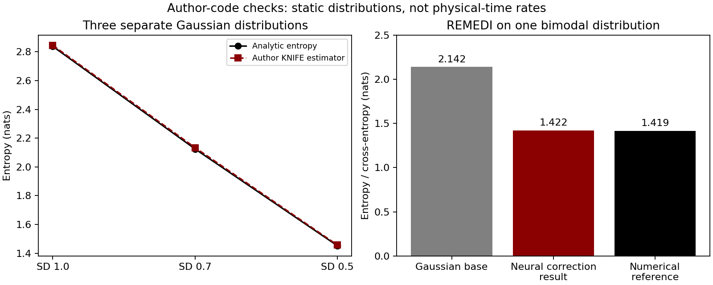

# Neural entropy and nonlinear LK: research and worked reading guide

Checked on 26 October 2026. Questions from Nir and Stéphane: neural entropy estimation and nonlinear LK calculation from observations.

## Findings

**Public neural entropy code and nonlinear LK equations exist. Their combination into online climate-variable transfer remains unvalidated.**

**KNIFE** and **REMEDI** estimate entropy. **Pires–Docquier–Vannitsem Causal Sensitivity Method (CSM)** calculates nonlinear LK: fit dynamics, fit conditional averages, then differentiate and average.

## Follow-up search

A [focused follow-up](05-followup-search.md) adds SBTM entropy evolution, learning dynamics from noisy observations, coarse sampling, discrete-time transfer, and excluded search results. Neither pass is exhaustive.

## Read in this order

1. [What neural methods estimate, with papers and code](01-neural-entropy-search.md). Start with the quantity table, then KNIFE and REMEDI.
2. [Pires, equation by equation](02-pires-walkthrough.md). Follow one actual Lorenz link from its equation to its final number.
3. [Source and code audit](03-provenance-and-code.md). Check the exact paper version, source locations, code commits, and execution status.
4. [Possible experiments and unresolved decisions](04-experiments-and-open-questions.md). These are research suggestions, not decisions already agreed with the team.

## Stepwise work completed

| Step | What was done | Where to inspect it |
|---|---|---|
| 1 | Distinguished entropy, entropy change, MI, transfer entropy, and LK | Quantity table in the search document |
| 2 | Searched primary papers and followed their author-code links | Literature table and search record |
| 3 | Traced Pires's model fitting, conditional regressions, slopes, and averaging | Equation walkthrough |
| 4 | Inspected selected source files from public author repositories | Code audit and pinned links |
| 5 | Ran an independent noise-free Lorenz calculation | [Code](code/lorenz_walkthrough.py), [numbers](results/lorenz/metrics.json), [figure](results/lorenz/lorenz_steps.png) |
| 6 | Ran author entropy code: KNIFE on Gaussians and REMEDI on a bimodal distribution | [KNIFE driver](code/check_knife_entropy.py), [REMEDI driver](code/check_remedi_entropy.py), [REMEDI numbers](results/remedi/metrics.json) |
| 7 | Recorded what remains to be tested for online nonlinear climate transfer | Experiment guide |

The Lorenz run generated numerical benchmark data; it used no climate observations. It is an independent reconstruction of selected formulas, not the authors' implementation or a replication of all their tables.

KNIFE fitted three separate static distributions; this did not test physical entropy change or causality.

## Three concrete results

In the Lorenz reconstruction, the linear covariance calculation for \(X_3\to X_2\) was about \(0.0000035\), while the nonlinear estimate was negative: approximately \(-0.888\) with degree-2 conditional regressions and \(-0.692\) with degree 10. The dependence on regression degree is recorded rather than hidden.

In the KNIFE check, exact entropies \(2.838,\ 2.125,\ 1.452\) nats were estimated as \(2.845,\ 2.134,\ 1.457\). These are small, one-seed Gaussian checks, with independent fitting and evaluation samples.

Using the REMEDI authors' actual neural network, a base-density estimate of 2.142 nats was corrected to **1.422**, against a numerical reference of **1.419**. This checks the neural entropy calculation on a static bimodal distribution.

## How this fits the existing notes

The [22 October meeting record](../nonlinear-information-flow-meeting-2026-10-22.md) preserves the handwritten questions about Gaussian mixtures, MINE, SMILE, and entropy. The [earlier calculation guide](../nonlinear-lk-calculation-and-followup.md) provides introductory definitions. The present folder adds source tracing, a broader method search, and executable checks.

The [private author-response note](../../mails-and-imp-notes/daniel-sorensen-code-and-method-followup.md) records why the semiconductor implementation cannot be shared. That response does not mean that every nonlinear LK implementation is unavailable.

